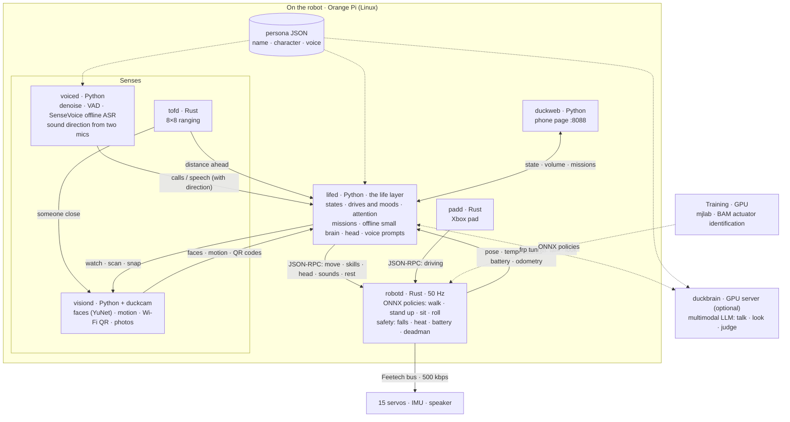
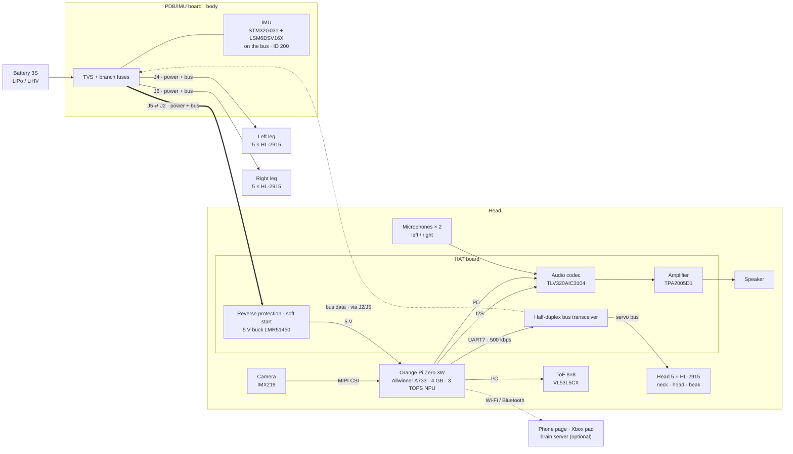

<h1 align="center">DuckBuddy</h1>

<b>An open-source embodied AI robot duck — it walks, hears, sees, and has a life of its own.</b>

A small embodied AI robot built on open hardware. It walks and runs, and step by step it adds voice, vision and behavior of its own.

🦆 <b>Make DuckBuddy your real-life buddy duck.</b>

English (translated from the upstream Chinese README) | <a href="README-EN.md">Upstream English README</a>

https://github.com/user-attachments/assets/7dd5c290-7b48-4f87-a991-7aab6c25632f

A string of spoken instructions, done one move after another (recorded on the robot, 2026-10-17; it has sound, so unmute the player).

📱 No video in the GitHub app? Open the GIF

3× speed, no sound. The full video: <a href="https://github.com/Animan-AI/DuckBuddy/raw/main/docs/media/demo.mp4">download demo.mp4</a> (5.7 MB), or open this page in a browser.

This is not just another robot duck. DuckBuddy brings **motion, perception, voice and a life layer** together in one open system that you can **build and improve**, and all of it runs on the robot itself, without a phone or the cloud.

DuckBuddy is built on [Pollen Robotics' Microduck](https://github.com/pollen-robotics/microduck). It is an independent community project, **not** affiliated with or endorsed by Pollen Robotics. See [NOTICE](NOTICE).

## What makes DuckBuddy special?

- 🦆 **Motion**: reinforcement-learning policies retrained for our Feetech HL-2915 servos: walking, getting up after a fall, sitting down and standing up, a forward roll (trained in sim). A 50 Hz loop that guards against falls, heat, a flat battery and a lost link
- 👂 **Hearing**: offline speech recognition (SenseVoice) with denoising and voice detection; two microphones in the head tell which side a voice came from, so it turns to look when you call it
- 👀 **Vision**: notices faces and things that move and turns to look, naturally (being tested on the robot); joins Wi-Fi from a QR code; "what is this?" is answered by a multimodal model when online
- 🧭 **Autonomy**: say a string of moves ("two steps forward, turn around, sit down") and it splits them into steps and does them in turn; walking a spoken route is being tested on the robot
- 💗 **A life layer**: drives and moods; it gets tired, rests and manages its servo temperatures (a hot head moves less); it answers in duck-speak rather than a text-to-speech voice; its name and character live in one persona file, so swap the file and you have a different duck

## Architecture

One picture of how it fits together: **perception** (hearing, vision, distance) reports events to the **life layer**, `lifed`, which decides where to look, what to do and what to say, and hands its intents to **robotd**, the only process that drives the servos. The gamepad outranks `lifed`. Online, `lifed` asks a **brain server** (a multimodal LLM) through an frp tunnel; offline, its own small brain answers. Every service runs on its own on the Orange Pi, and they talk JSON over local Unix sockets.

For developers: the editable Mermaid diagram

## Hardware & Software

### Hardware at a glance

|  | Original Microduck | DuckBuddy |
|---|---|---|
| Main board | Radxa Zero 3W (RK3566, 1 GB) | **Orange Pi Zero 3W** (Allwinner A733: 2×A76 + 6×A55, 4 GB, 3 TOPS NPU) |
| Servos | 15 × Dynamixel XL330 (2S) | 15 × **Feetech HL-2915** (3S); HD-1910 (2S) on the way |
| Carrier boards | Pollen's HAT | our **HAT** (audio codec, two microphones, speaker amp, ToF, 5 V supply, servo bus) and **PDB/IMU** (power distribution + an IMU on the servo bus) |
| Sensors | IMU | IMU, two microphones, IMX219 camera, 8×8 ToF ranging |
| Policies | Pollen's | **retrained for the HL-2915**, in `training/` |
| Behavior | a gamepad or the app | a **life layer** on the robot, in `tools/lifed` |

The battery plugs into the PDB/IMU board in the body, which splits it three ways: left leg, right leg, head. Each branch carries power and the servo bus. The HAT and the Orange Pi are stacked together in the head: the HAT brings the battery down to 5 V for the Orange Pi, connects its UART to the servo bus, and does the sound (two microphones in, a speaker out). The 15 servos and the IMU share one bus.

For developers: the editable Mermaid diagram

Our own two boards, the HAT and the PDB/IMU:

### Software stack

| Service | Language | What it does |
|---|---|---|
| `robotd` | Rust | the 50 Hz control loop running ONNX policies; Feetech HLS bus driver, battery identification (2S/3S, LiPo/LiHV), heat and fall guards |
| `lifed` | Python | the life layer: state machine, drives and moods, attention, missions, an offline small brain, head motion |
| `voiced` | Python | denoising, voice detection, offline recognition (SenseVoice), sound direction from two microphones |
| `visiond` | Python | the camera: faces (YuNet), motion detection, Wi-Fi by QR code, snapshots |
| `tofd` | Rust | 8×8 ToF ranging: distance ahead, someone close |
| `padd` | Rust | Xbox gamepad over Bluetooth; outranks `lifed` |
| `duckweb` | Python | a phone page: state, battery, conversation, volume |
| `duckbrain` | Python | optional, on a GPU server: any OpenAI-compatible multimodal LLM, for conversation and looking at pictures |
| `persona` | JSON | the persona: name, character, how it talks, kept apart from the code |

### Verified platforms

| Combination | Status |
|---|---|
| Orange Pi Zero 3W 4 GB + 15 × HL-2915 + 3S battery (LiPo 1500 mAh / LiHV 2800 mAh) | ✅ whole robot in daily use |
| Orange Pi Zero 3W + 15 × HD-1910 + 2S battery | 🚧 boards being assembled; servo driver and policies to do |
| Original Microduck (Radxa Zero 3W + Dynamixel XL330) | ⚪ the Dynamixel bus driver is unchanged; not tested by us on a real robot |

### Progress

| When | Done |
|---|---|
| 2026-08 | Started from Microduck; sorted out the original hardware and software |
| 2026-09 | Designed the HAT (R3E) and PDB/IMU (R2f) boards; fabricated and assembled |
| early 2026-10 | Feetech HL-2915 servo driver, IMU firmware; actuator identification (BAM); walk, stand-up and sit-down policies retrained |
| 10-13 | Xbox gamepad over Bluetooth |
| 10-14 | The life layer: drives, moods, rest, servo heat budget |
| 10-15 – 16 | Voice: offline recognition, duck-speak replies, conversation with the online brain |
| 10-17 | Wi-Fi by QR code, voice prompts, volume, "what is this?", missions (a spoken string of moves done in turn), odometry calibration |
| 10-18 | Sound direction from two microphones, attention with vision guidance (faces, motion), automatic battery identification (2S/3S, LiPo/LiHV), persona apart from the framework, open source |

| Area | What | Status |
|---|---|---|
| New skills | Forward roll, picking a cloth up from the floor (trained in sim, robot test next) | 🚧 in progress |
| Attention | Vision-guided head turning, tested on the robot | 🚧 in progress |
| Missions | Walking a spoken route on the robot | 🚧 in progress |
| 2S version | HD-1910 servos + 2S battery | 🚧 in progress |
| NPU | Object detection, fed into the attention | 📋 planned |
| On-device multimodal model | MiniCPM-V 4.7 1B, so it can "see" things offline too | 📋 planned |
| Localization | AprilTag landmarks → visual odometry → a room-level map | 📋 planned |
| Voice | Wake word, noisy rooms, two-mic beamforming | 📋 planned |
| Docs | English translations, a full build guide | 📋 planned |

## Build Your Own DuckBuddy

| Step | Where | Status |
|---|---|---|
| 1. Get the parts | the parts list below | ✅ list · 🚧 shop links coming |
| 2. 3D print | [hardware/print](hardware/print/README.md): Bambu Studio project `DuckBuddy.3mf`, 6 plates, PETG + TPU, settings included. Optional open development head for the Robot HAT E1: [hardware/cad/open-head](hardware/cad/open-head/README.md); optional LiPo plate with the BNO055 mount: [hardware/cad/lipo-plate](hardware/cad/lipo-plate/README.md) | ✅ |
| 3. Carrier boards | interfaces (pinouts, power, bus): [docs/hardware/INTERFACE-CN.md](docs/hardware/INTERFACE-CN.md). The PCB design files are not public; you can buy assembled boards from the maintainer (contact them in the group chat), or design your own to the interface. An open PDB/IMU R3 board (not yet fabricated) is in [hardware/pcb/pdb-imu](hardware/pcb/pdb-imu/README.md) | ✅ interface |
| 4. Flash the IMU firmware | [firmware/imu-feetech](firmware/imu-feetech/README.md): ST-Link on the PDB's J2, one `probe-rs` command | ✅ |
| 5. Set up the Orange Pi system and services | service configs in [deploy/opi-dev](deploy/opi-dev/README.md), robot configs in [deploy/robots](deploy/robots) | 🚧 one-step installer coming |
| 6. Servos, zero pose, whole-robot test | [tools/bringup](tools/bringup/README.md): a web workbench you open on your computer: servo IDs, joint mapping, zero calibration, IMU firmware, whole-robot self-test, each page with an illustrated guide. New servos can also be set up on a Raspberry Pi test bench with the Robot HAT E1 instead of the Feetech USB board (`--bench`) | ✅ |
| 7. Policies | trained policies ship in the repo and can be used as they are; to train your own see [training](training) | ✅ |
| 8. Give it a character | [tools/persona](tools/persona/README.md): write your own persona JSON after the example duck | ✅ |
| 9. Assembly guide, FAQ | a short FAQ below; an illustrated assembly guide is coming | 🚧 |

### Parts list

| Part | Qty | Notes |
|---|---|---|
| Feetech HL-2915 servo | 15 | the 3S version; 2 × 5 in the legs, 5 in the head (neck, head, beak). Microduck's printed parts fit as is, M2×6 self-tapping screws |
| Orange Pi Zero 3W | 1 | the 4 GB version recommended |
| HAT carrier board | 1 | in the head, stacked on the Orange Pi. This fork uses the Robot HAT E1 ([docs/hardware/INTERFACE-CN.md](docs/hardware/INTERFACE-CN.md), section 6): it takes the battery and feeds the servos itself |
| PDB/IMU board | 1 | in the body. Not used in this fork: a BNO055 breakout (Adafruit 4646) on a Qwiic cable to the HAT's J5 is the body IMU, mounted on the [LiPo plate](hardware/cad/lipo-plate/README.md) |
| IMX219 camera module | 1 | MIPI CSI, in the face |
| 8×8 ToF module (VL53L5CX) | 1 | in the face |
| Small speaker | 1 | on the HAT's amplifier |
| 3S battery | 1 | LiPo 1500 mAh or LiHV 2800 mAh; robotd identifies it automatically. With the Robot HAT E1: an XT60 plug |
| PETG and TPU filament | as needed | TPU for the soft parts (soles, soft beak and so on) |
| Xbox gamepad | 1 | optional, Bluetooth remote control |

### FAQ

- **2S or 3S?** The HL-2915 runs on 3S. The HD-1910 runs on 2S, and the HAT needs only one resistor changed (R11); everything else is the same. At start-up robotd identifies the number of cells and the battery type, and refuses to power the servos if they do not match the configuration.
- **The servos have power but don't move?** Feetech HLS servos do not move while their "target current" and "running speed" are 0. robotd writes them at start-up; remember to set them in your own test scripts.
- **It stops answering the stick after a while?** Most likely the head servos' overheat protection. The head has little cooling, and the life layer uses a temperature budget to make it move less and rest more.
- **Does the original Microduck run this software?** In software terms yes, the Dynamixel bus driver is unchanged, but we have not tested it on the original hardware.

## Join the Community

[Issues](https://github.com/Animan-AI/DuckBuddy/issues) and pull requests are welcome; see [CONTRIBUTING.md](CONTRIBUTING.md) for building and testing. We would especially like help with:

- the HD-1910 servo driver;
- NPU object detection, fed into the attention module;
- AprilTag localization for the mission layer;
- the build guide and English translations.

Repository layout

| Path | What |
|---|---|
| `robotd`, `duck-control`, `kinematics`, `padd`, `robotctl`, … | the Rust workspace (from Microduck, extended) |
| `tools/` | the Python services: `lifed`, `voiced`, `visiond`, `duckweb`, `duckbrain`, `persona`, the bring-up workbench `bringup`, and robot test scripts |
| `firmware/imu-feetech` | the IMU board's firmware (STM32G031 + LSM6DSV16X, speaks the Feetech protocol) |
| `training/` | HL-2915 training tasks, actuator identification (BAM), evaluation scripts, trained policies |
| `hardware/` | the print project (`hardware/print`), the robot model used for training (`hardware/rev-a/mjcf`); the open PDB/IMU R3 board (`hardware/pcb/pdb-imu`, tscircuit); the open head shell (`hardware/cad/open-head`, an organic frame generated in Python), the LiPo plate (`hardware/cad/lipo-plate`, build123d) |
| `docs/` | the hardware interface (`docs/hardware`), and Microduck's own design notes and guides |

Come and chat in the group about playing with it, building, debugging and training. Scan the QR code with WeChat to join:

The group QR code is updated every week; if it has expired, please open an issue and we will replace it soon.

---

License: software Apache-2.0 (same as Microduck), documentation CC-BY-4.0; some components have their own licenses, see [NOTICE](NOTICE).
