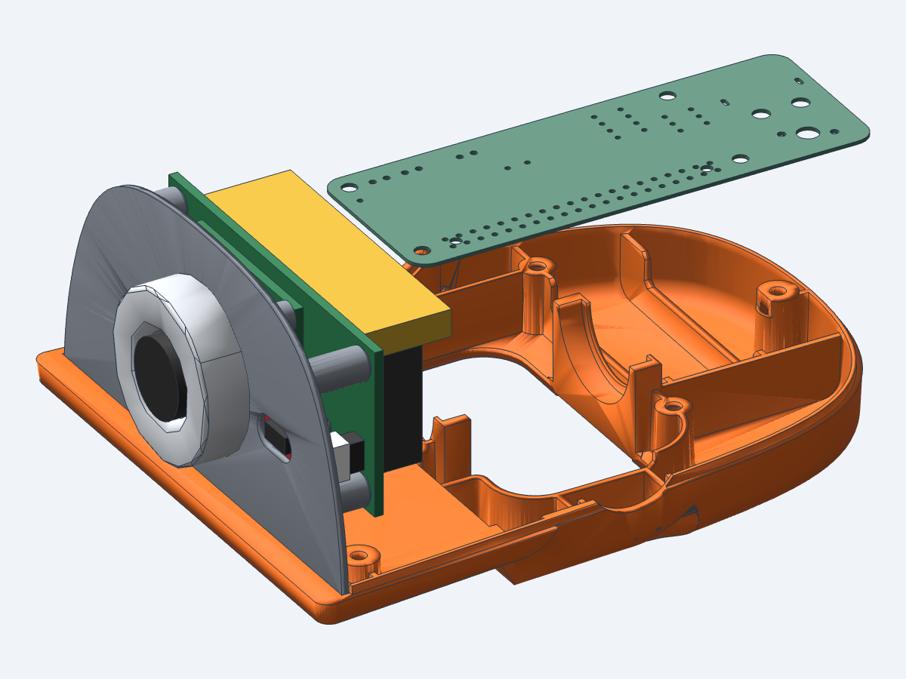
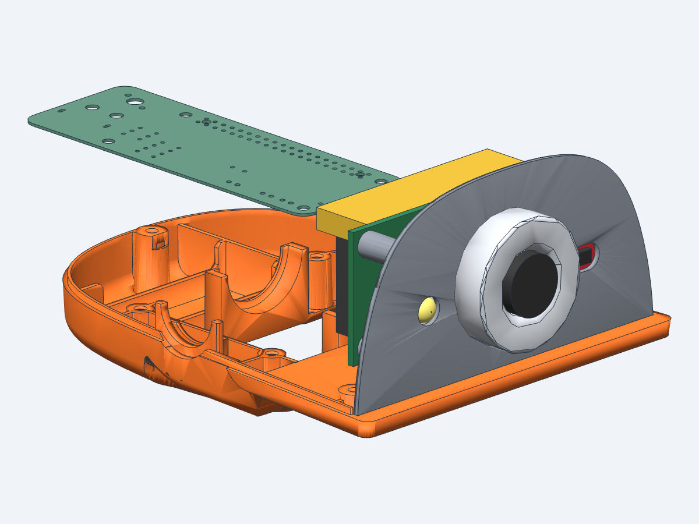

# Face plate for the Radxa camera, the SparkFun ToF and an LED

The head's face plate (`face_part` in [`hardware/print/DuckBuddy.3mf`](../../print/README.md))
with its two sensor mounts changed, for the
**[Radxa Camera 8M 219](https://docs.radxa.com/en/cubie/a7z/accessories/camera-8m-219)** (IMX219,
32 × 32 mm board) and the
**[SparkFun Qwiic Mini ToF Imager - VL53L5CX](https://www.sparkfun.com/sparkfun-qwiic-mini-tof-imager-vl53l5cx.html)**
(25.4 × 12.7 mm board), with a hole for a **1 W LED** on the other side of the camera. It goes into the head exactly as the plate in the 3MF does, under the
original top shell or the [open head](../open-head/README.md). Compared with that plate:

- **camera**: the four standoffs for the old IMX219 board (21 × 13.5 mm hole pattern) are gone.
  Four round standoffs, 5 mm across with M2 pilots, stand on the Radxa board's 28 × 28 mm holes,
  centred on the lens hole. The board rests on them with its lens side, lens through the plate.
  The lens hole is 15 mm (it was 14.5): the lens barrel is 14 mm at most on Radxa's drawing;
- **ToF**: the old ToF frame is gone (a 3 mm frame for a board with 19.8 mm hole pitch), and its two
  blind screw holes are filled. The SparkFun Mini lies on the plate's back on four 0.3 mm pads, its
  sensor in the plate's ToF window, held by two 3 mm pins through its 20.32 mm holes. It has to sit
  this close to the plate: its Qwiic connectors stand 4.25 mm off its back, and the one at the
  camera end would hit the camera board if the ToF board sat further back;
- **LED**: a 6.4 mm hole on the robot's right of the camera, the mirror of the ToF window, for a
  1 W high-power LED emitter. A cup on the back centres the LED body, with slots up and down for
  its two leads. The LED's collar rests on the plate's back face and its dome looks out through
  the hole.

Everything else is the same: the outline, the four Pi standoffs, the ToF window on the front and the
three slots for the eye piece, so the face looks as before apart from the LED hole. The plate is made by editing the
DuckBuddy plate's mesh, so there is no STEP file.





## Print

| File | Use |
|---|---|
| `STL/face_plate.stl`, `3MF/face_plate.3mf` | printing (the same mesh) |

PETG, 0.2 mm layers, 2 walls, 30% infill, as the other parts in `hardware/print`. The files are
oriented front face down on the bed: the standoffs and the pins point up and nothing
overhangs, so no supports are needed. 88 × 45 × 12.5 mm.

## Parts and assembly

| Item | Qty | Where |
|---|---|---|
| Radxa Camera 8M 219 | 1 | behind the plate, lens through the hole |
| M2 × 5 self-tapping screw | 4 | through the board's corner holes into the standoffs (pilots 1.6 mm, 6 mm deep) |
| FPC cable, 15-pin 1.0 mm pitch on the camera side | 1 | to the main board's MIPI CSI connector |
| SparkFun Qwiic Mini ToF Imager - VL53L5CX (SEN-19013) | 1 | on the plate's back, sensor in the ToF window |
| Qwiic cable (JST SH 4-pin) | 1 | from the ToF's outer connector to the HAT's J8 |
| 1 W LED emitter ([the one used](https://www.amazon.fr/dp/B07C97WKHD), warm white, about 3.3 V, 330 mA) | 1 | in the cup on the robot's right of the camera |
| Two wires and a current limit for the LED | | soldered to its leads; it needs a driver or a resistor, it cannot go straight on a GPIO |

1. Push the lens through the hole from the back and set the board's corners on the four
   standoffs, with the FPC connector at the bottom edge (that is the drawing's orientation, the
   picture is upright). Screw it down with the four M2 screws.
2. The cable leaves the connector downwards. There are 4 mm between the board's bottom edge
   and the shell floor behind the plate, and 1 mm between the connector and the Pi: fold the
   cable back towards the main board's connector. If it routes better upwards, mount the board
   turned by 180° (the standoffs are symmetric) and turn the picture in software.
3. Set the ToF board on the two pins, sensor side to the plate, mounting holes up: the sensor
   drops into the window. Fix it by melting the pin tips over the board with a soldering iron
   (they stand 1.5 mm out of the board), or with a drop of glue on each pin.
4. Plug the Qwiic cable into the ToF's connector on the outer end (the robot's left, away from
   the camera). Leave the connector at the camera end empty: it sits 0.8 mm in front of the
   camera board, with no room for a plug.
5. Solder the wires to the LED's leads first, then push the LED into its cup from the back,
   dome first, leads in the two slots (one up, one down). A drop of glue on the rim of the cup
   holds it.
6. The rest as before: the Pi on its standoffs, the plate into the bottom shell.

Notes:

- The ToF board's holes are 3.3 mm for #4 or M3 screws, but the plate is too thin behind the
  board for a screw, hence the pins.
- The ToF board lies with its long side across the face, its sensor at the old window's centre,
  so the depth image keeps its orientation from the old mount only if the old board was turned
  the same way: check it in `tofd` after assembly.
- **The LED's size is partly assumed.** The seller gives the collar (7.3 mm), the lead span
  (15 mm) and the heat slug (6 mm). The body (8.0 mm), the dome (5.6 mm, 2 mm high) and the
  lengths are the usual sizes of these emitters. Measure one before printing; the numbers are
  `LED_*` in `head_params.py`. The collar rests on a 0.45 mm wide seat around the hole.
- At its full 1 W the LED needs a heat sink on its slug, which the cup does not give: run it at a
  lower current (a few tens of mA is plenty as an indicator), or glue a small heat sink on its back.
- The Qwiic cable leaves the outer connector backwards and has 2.9 mm to the Pi before it must
  bend.
- The eye piece (Microduck's `noenoeil`, in front of the plate) has a 14.3 mm hole and the lens
  barrel is 14 mm on the drawing. The fit is not known: the two parts come from different
  sources and their reference meshes disagree by 0.3 mm sideways. It may need opening up a
  little.
- The lens stands 8.5 mm in front of the plate (the original Microduck lens: 8.4 mm).

## Geometry

Head frame: X forward, Y to the robot's left, Z up, in mm, origin on the head-roll servo axis
(as in [`../open-head`](../open-head/README.md)). All dimensions are in
`../open-head/src/head_params.py` (the camera and face plate sections).

| Item | Value |
|---|---|
| Plate | back face at X 72.08, front face at X 73.39; outline Y ±43.8, Z −5.3 to 39.3 |
| Lens axis | the plate's hole: Y 0.13, Z 15.51 |
| Camera board | 32 × 32 × 1.6 at X 64.3 to 65.9; lens module 16 mm long, to X 81.9; FPC connector on the back at the bottom edge, taken as 18 × 4.5 × 2.5 mm |
| Standoffs | 5 mm round at (Y ±14, Z 1.5 and 29.5) about the lens axis, tops at X 65.9, M2 pilots 1.6 mm × 6 mm with a 0.4 mm chamfer |
| Lens hole | 15 mm |
| Pi | board at X 59.2 to 60.8: the FPC connector is 1.0 mm in front of it |
| ToF board | 25.4 × 12.7 × 0.8 at X 70.98 to 71.78, Y 9.9 to 35.3, Z 9.7 to 22.4; sensor 6.4 × 3.0 × 1.5 centred on the window (Y 22.63, Z 13.5), its face 0.11 mm behind the plate's front |
| ToF window | the old one: 10.75 × 6 mm through the plate |
| ToF pins | 3.0 mm at (Y 12.47 and 32.79, Z 19.85) on 5.5 mm pads, 0.3 mm tall; tips 1.5 mm past the board's back, chamfered; two 2.4 mm square pads under the lower corners |
| LED | at Y −22.63, Z 13.5; hole 6.4 mm; cup 8.6 mm inside, 1.2 mm wall, 2.6 mm deep, lead slots 3 mm wide along Z; dome 0.7 mm out of the plate's front |
| ToF connectors | 4.25 mm tall on the board's back at both ends: the one at the camera end is 0.83 mm from the camera board |

## Files

| Path | What |
|---|---|
| `src/face_plate.py` | the generator: the DuckBuddy plate mesh, edited with manifold3d |
| `checks/fit_check.py` | the fit check (below) |
| `../open-head/src/head_params.py` | the dimensions (camera and face plate sections) |
| `../open-head/src/assembly.py` | the camera, ToF and LED stand-ins (boards, lens module, sensor, connectors) with the other head parts |
| `../open-head/reference/` | the DuckBuddy plate, the bottom shell and the Microduck parts in the head frame |

## Build and check

The generator needs the head parts file from `../open-head` (made with
[text-to-cad](https://texttocad.dev) on the first run), then takes a few seconds:

```bash
uv run src/face_plate.py
```

It writes `tmp/face_plate.stl` (head frame), `tmp/face_plate_review.glb` (with the camera, the
ToF board, the LED, the Pi, the bottom shell and the eye piece) and the print files in `STL/` and `3MF/`. Open the review
file in the CAD viewer:

```bash
cad viewer tmp/face_plate_review.glb
```

Then check it (about half a minute):

```bash
uv run checks/fit_check.py
```

It checks, in the head frame:

- the plate is one closed solid and, away from the camera, ToF and LED mounts, the DuckBuddy plate
  unchanged (every point of the reference surface outside the changed areas lies on it, within
  0.02 mm);
- the camera board rests on the four standoffs, each pilot is on a board hole, and the board,
  the lens and the FPC connector overlap nothing of the plate;
- the lens clears the plate's hole by 0.4 mm, the camera clears the Pi by 0.5 mm and the bottom
  shell by 1 mm;
- the ToF board rests on its pads, each pin is in a board hole, the sensor clears the window by
  0.4 mm and ends behind the front face, the ToF parts overlap nothing of the plate, and they
  clear the camera and the Pi by 0.5 mm;
- the LED's collar rests on the plate's back, its dome clears the hole by 0.3 mm, it overlaps
  nothing of the plate and clears the camera and the Pi by 0.5 mm;
- how close the lens barrel comes to the eye piece's hole (reported only).

Last result: PASS. Unchanged within 0.02 mm; lens 1.5 mm from the plate; FPC connector 1.0 mm
from the Pi; camera 3.9 mm from the bottom shell. ToF: pins 0.15 mm from the hole walls, sensor
1.3 mm from the window and 0.11 mm behind the front face, the camera-end connector 0.83 mm from
the camera, the cable plug 2.9 mm from the Pi. LED: dome 0.4 mm from the hole, body 0.3 mm
from the cup, 3.8 mm from the camera. The open head's check
(`../open-head/checks/fit_check.py`) includes all three: the camera 5.9 mm, the ToF 1.3 mm and the
LED 8.3 mm from the shell, all more than 20 mm from the moving neck parts.
