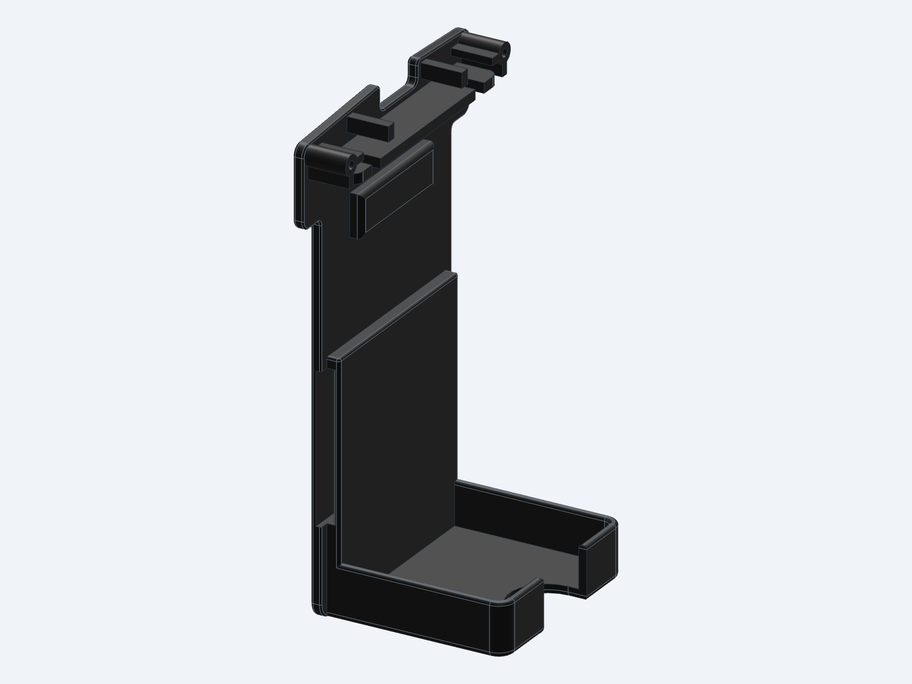
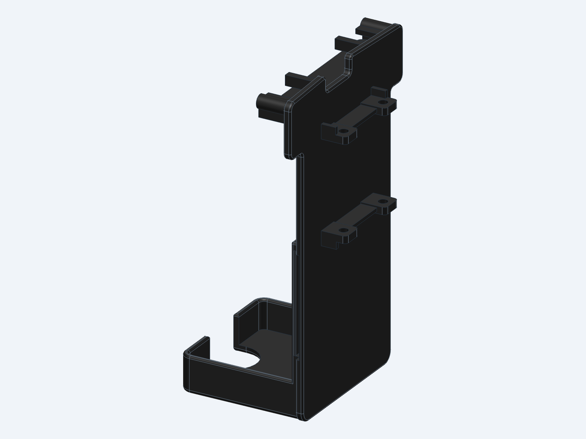

# LiPo plate

A new battery plate for the body. It replaces `power_support` in
[`hardware/print/DuckBuddy.3mf`](../../print/README.md) and goes in the same way: it slides up
into the two body shells and is held by the same locker. It holds:

- a **3S LiPo**, OVONIC 2200 mAh 35C, 75 × 33 × 26 mm (±3 mm), 139 g, XT60. It stands upright on
  a pad on the plate's back, its bottom in a shallow cup with 8 mm lips, its top just under the
  shell's lip. One **27 mm velcro strap** goes around the pack and through a flat channel in the
  pad, behind the BNO055;
- the **BNO055 breakout** (Adafruit 4646) on four low standoffs on the plate's front face,
  inside the body, just under the hip servos. That is next to the IMU site of the robot model
  the policies were trained with (2 mm in front of it, 2.3 mm lower), so the sensor reads as the
  simulated one does, and the legs and the plate around it keep it out of reach. It stands on
  end, so it is only 20.3 mm wide: the hip-roll servos swing in front of it on both sides.

The top of the plate (the shelf, the hinge knuckles and the blocks that meet the shells and the
locker) is the old plate's, measured from the print part. The rest is new and drawn from scratch
in build123d, with rounded corners and edges. Compared with the old plate it drops the NP-F970
holder, the zip-tie slots and the front mounts of the PDB/IMU board (not used in this fork).

The shape was checked in the robot's simulation with the policies in `training/policies`
(walking, getting up, sitting down and up, the forward roll): see [Checks](#build-and-check).
The plate's bottom stops at the cup (Z −49.5) and the pack sits only 2.4 mm further back than
the old plate's back face because the forward roll needs it: with the body reaching down to
Z −55 the robot stopped on its back in 4 of the 5 stress conditions.





## Print

| File | Use |
|---|---|
| `STL/lipo_plate.stl`, `3MF/lipo_plate.3mf` | printing (the same mesh) |
| `STEP/lipo_plate.step` | editing in another CAD program |

PETG, 0.2 mm layers, 2 walls, 30% infill, as the other parts in `hardware/print`. Print it
standing on its flat bottom (the plate's lower edge and the cup's rim), with supports under the
shelf and the hinge knuckles at the top. About 38 × 55 × 89 mm, 14.3 cm³.

## Parts and assembly

| Item | Qty | Where |
|---|---|---|
| OVONIC 3S 2200 mAh 35C LiPo (75 × 33 × 26 mm), XT60 | 1 | on the plate's back |
| Velcro strap, 27 mm wide, up to 2 mm thick, about 20 cm | 1 | around the pack, through the pad's channel |
| Adafruit BNO055 breakout (4646) | 1 | on the plate's front face |
| M2.5 × 4 self-tapping screw | 4 | through the BNO055's holes into the standoffs (2.6 mm deep pilots; longer screws reach the strap channel) |
| Qwiic / STEMMA QT cable, about 30 cm | 1 | BNO055 to the [Robot HAT E1](https://code.caric.io/Robotics/elec_RPI_Robot_HAT)'s J5 |

1. Screw the BNO055 on the four standoffs, its parts facing forward (away from the plate), its
   long side up. Plug the Qwiic cable into the socket at its bottom edge (the top one has no
   room: the hip servos are 1.3 mm above the board).
2. Slide the plate up into the shells and fit the locker, as with the old plate. Run the Qwiic
   cable from the bottom of the board along the plate's front face to one of its edges and up
   through the body to the head, with slack through the neck. Keep it flat on the plate: the
   hip-roll servos swing in front of the board, to 3.5 mm from its parts.
3. Thread the strap through the channel in the pad (it opens at the pad's left and right sides,
   between Z −32.5 and −4.5), before the plate goes in if that is easier.
4. Stand the pack on the cup's floor, flat on the pad, its leads down: they leave through the
   opening in the back of the cup. Wrap the strap around the pack and pull it tight.
5. Measure `[bus] imu_axes` with the bring-up tool (`tools/bringup`, "Whole-robot test" page, IMU
   line): with the board standing upright and its chip facing forward, expect the trunk's x to be
   the sensor's z.

## Geometry

All numbers use the **trunk frame**: X forward, Y to the robot's left, Z up, in mm, the frame of
the `trunk_base` body in the Microduck model. All dimensions are in `src/plate_params.py`.

| Item | Value |
|---|---|
| Plate | back face X −23, front face X −21, edges at Y ±21.4 below the shells, bottom Z −49.5 |
| Pad | the pack rests on it at X −25.4, Y ±19.5, from the cup up to Z −2.5; a rib at Z 16 to 24 keeps the pack parallel |
| Strap channel | 2.2 × 28 mm, Z −32.5 to −4.5, from X −24.2 to −22 (1 mm into the plate, 1 mm of plate left in front) |
| LiPo | on the pad, the largest pack (78 × 36 × 29) from Z −47.5 to 30.5 (0.74 mm under the shell's tube) |
| Cup | floor top Z −47.5, 2 mm thick, lips 1.5 mm thick and 8 mm high, inside 36 × 29.75 mm |
| BNO055 | on end, board X −19 to −17.4, Y ±10.16, Z −29.7 to −4.3 (1.3 mm under the hip servos), centre Z −17.0; standoffs 2 mm high, Ø4.5; Qwiic plug down from the bottom edge |

## Build and check

```bash
uv run src/build_plate.py
uv run tools/policy_poses.py
uv run checks/fit_check.py
uv run tools/policy_videos.py
```

`src/build_plate.py` builds `src/plate.py` with text-to-cad and writes the STL, 3MF and STEP in
`tmp/`, and `tmp/lipo_plate_review.glb` with the pack, the board and the trunk parts around it.
`tools/policy_poses.py` runs the robot's policies in the simulation (the BAM HL-2915 model, as
`training/policies/README.md` tests them), once with the old battery and once with the LiPo
plate, and records each skill's score and the joint angles. The LiPo plate's run puts boxes for
its shape (the largest pack, the cup, the pad, the rib, the BNO055 with its plug) in the collision
model, and changes the trunk's mass: it takes out the 119.6 g pack the robot was weighed with and
the old plate, and puts in the 139 g OVONIC pack, the new plate (PETG, from its mesh) and the
BNO055 (3 g). The trunk goes from 206.2 g to 233.4 g, its centre of mass from (X −19.5, Z +3.8) to
(X −22.6, Z −2.1) mm, and the robot from 850 g to 877 g.
`checks/fit_check.py` measures the plate against the trunk and compares the two runs: see its
header. `tools/policy_videos.py` films the policies in the LiPo plate's scene, with the plate, the
pack and the board shown, from behind the robot (`tmp/lipo_plate_policies.mp4`).

Last results (largest pack, BNO055 with its plug, the LiPo plate's masses):

| Check | Result |
|---|---|
| Policies in the simulation, old battery / LiPo plate | walk 9/10 / 9/10, stand-up 35/35 / 35/35, sit/stand 5/5 / 5/5, forward roll 4/5 / 4/5 |
| Legs and head to the BNO055, in every policy pose | 3.55 mm at the nearest |
| Overlap with the locker and the shells | 0.14 and 0.01 mm³ (the old plate: 14.42 and 0.01, where it sits in their grooves) |
| New parts to the shells, sliding the plate in | 4.1 mm |
| Largest pack to the locker / the shells | 0.92 / 0.76 mm |
| Lowest point above the floor, sitting | plate 17.5 mm, pack 20.2 mm (old battery 22.8 mm) |

The legs and the head touch the pack and the plate in the simulation, as they touch the old
battery: when the robot lies on its back, gets up or rolls.

Reference meshes (`reference/`): the trunk parts of the Microduck model in the trunk frame
(`tools/trunk_meshes.py`) and the print parts of `DuckBuddy.3mf` fitted to them
(`tools/align_parts.py`).
