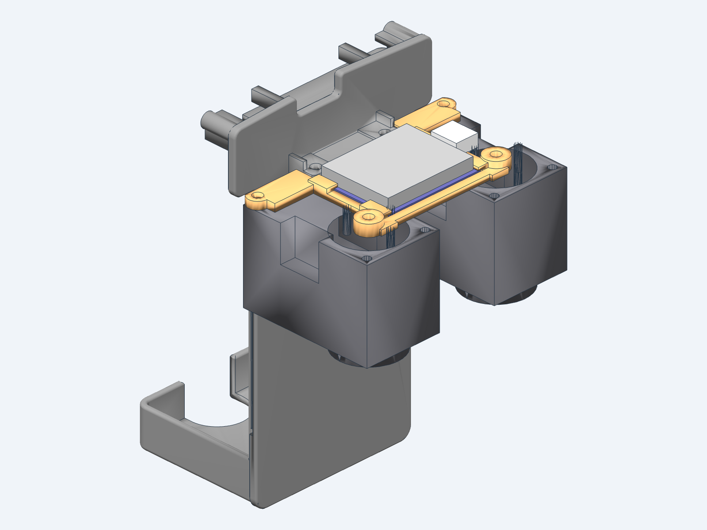

# LiPo plate and BNO055 mount

A new battery plate for the body. It replaces `power_support` in
[`hardware/print/DuckBuddy.3mf`](../../print/README.md) and goes in the same way: it slides up
into the two body shells, is held by the same locker, and its two brackets screw it to the two
rear hip servos, under them and on their tops, as the old plate's do. It holds

 a **3S LiPo**, OVONIC 2200 mAh 35C, 75 × 33 × 26 mm (±3 mm), 142 g weighed (139 g on its label), XT60. The pack stands upright
on a pad on the plate's back, its bottom in a shallow cup with 8 mm lips, its top just under the
shell's lip. One **27 mm velcro strap** goes around the pack and through a flat channel in the pad.

The **BNO055 breakout** (Adafruit 4646) lies flat, chip up, straight on the tops of the two rear
hip servos, its long side across the robot, held by a thin frame of its own (`imu_mount`). The
frame is screwed into each servo's horn screw hole (the passive horns on these two servos are left
off) and into their free outer top holes, where DuckBuddy's PDB/IMU board goes
([`hardware/pcb/pdb-imu`](../../pcb/pdb-imu/README.md)). The board slides into the frame from
behind, under a lip along each side, up to the front rail; the plate's upper bracket tabs, 0.2 mm
behind it, keep it from sliding back out. It sits this low because the head bows forward when the
robot gets up and rolls, and the neck then comes down to Z 31 over the front of the servos
(`tools/head_reach.py`). It is on the trunk, the same rigid body as the IMU site of the robot model,
so the gyro and the gravity direction the policies read are the same.

The top of the plate (the shelf, the hinge knuckles and the blocks that meet the shells and the
locker) and the two servo brackets are the old plate's, measured from the print part. The rest is
new and drawn from scratch in build123d, with rounded corners and edges. Compared with the old
plate it drops the NP-F970 holder and the zip-tie slots.

The shape was checked in the robot's simulation with the policies in `training/policies`
(walking, getting up, sitting down and up, the forward roll): see [Checks](#build-and-check).
The plate's bottom stops at the cup (Z −49.5) and the pack sits only 2.4 mm further back than
the old plate's back face because the forward roll needs it: with the body reaching down to
Z −55 the robot stopped on its back in 4 of the 5 stress conditions.




## Print

| File | Use |
|---|---|
| `STL/lipo_plate.stl`, `3MF/lipo_plate.3mf` | the plate, for printing (the same mesh) |
| `STL/imu_mount.stl`, `3MF/imu_mount.3mf` | the BNO055 mount, for printing |
| `STEP/lipo_plate.step`, `STEP/imu_mount.step` | editing in another CAD program |

PETG, 0.2 mm layers, 2 walls, 30% infill, as the other parts in `hardware/print`. Print the plate
standing on its flat bottom (the plate's lower edge and the cup's rim), with supports under the
shelf, the hinge knuckles and the servo brackets. About 43 × 55 × 89 mm, 14.6 cm³. Print the mount
on its flat underside: no supports (the side lips reach 1 mm over the board). 28 × 56.5 × 3 mm,
0.8 cm³.

## Parts and assembly

| Item | Qty | Where |
|---|---|---|
| OVONIC 3S 2200 mAh 35C LiPo (75 × 33 × 26 mm), XT60 | 1 | on the plate's back |
| Velcro strap, 27 mm wide, up to 2 mm thick, about 20 cm | 1 | around the pack, through the pad's channel |
| M2 screws, as for the old plate | 4 | the plate's brackets into the rear hip servos' inner holes, two from below, two from above |
| Adafruit BNO055 breakout (4646) | 1 | on the mount |
| M2 × 6 self-tapping screw | 2 | through the mount's arms into the rear hip servos' outer top holes (2 mm of mount, about 4 mm into the servo) |
| The passive horns' screws | 2 | through the mount's bosses into the rear hip servos' horn screw holes (the bosses are 3 mm tall, as the horns, so the same screws fit) |
| Qwiic / STEMMA QT cable, about 30 cm | 1 | BNO055 to the [Robot HAT E1](https://code.caric.io/Robotics/elec_RPI_Robot_HAT)'s J5 |

1. Take the passive horns off the tops of the two rear hip servos and keep their screws.
2. Before the shells go on (as for DuckBuddy's PDB/IMU board), set the mount on the servo tops,
   its bosses on the horn screw holes and its arms on the outer top holes, and screw it down with
   the horn screws and two M2 × 6 screws.
3. Slide the BNO055 into the frame from behind, chip up, its long side across, under the side lips
   up to the front rail. Plug the Qwiic cable into the socket at the board's left end and run it up
   through the neck to the head, with slack for the head's motion.
4. Fit the plate as the old one: slide it up into the shells, screw its two brackets to the rear
   hip servos (the lower one from below, the upper one from above) and fit the locker. The upper
   bracket's tabs now sit just behind the board and keep it in the frame.
5. Thread the strap through the channel in the pad (it opens at the pad's left and right sides,
   between Z −32.5 and −4.5), before the plate goes in if that is easier.
6. Stand the pack on the cup's floor, flat on the pad, its leads down: they leave through the
   opening in the back of the cup. Wrap the strap around the pack and pull it tight.
7. Measure `[bus] imu_axes` with the bring-up tool (`tools/bringup`, "Whole-robot test" page, IMU
   line): with the board lying flat, chip up, expect the trunk's z to be the sensor's z.

## Geometry

All numbers use the **trunk frame**: X forward, Y to the robot's left, Z up, in mm, the frame of
the `trunk_base` body in the Microduck model. All dimensions are in `src/plate_params.py`.

| Item | Value |
|---|---|
| Plate | back face X −23, front face X −21, edges at Y ±21.4 below the shells, bottom Z −49.5 |
| Pad | the pack rests on it at X −25.4, Y ±19.5, from the cup up to Z −2.5; a rib at Z 16 to 24 keeps the pack parallel |
| Strap channel | 2.2 × 28 mm, Z −32.5 to −4.5, from X −24.2 to −22 (1 mm into the plate, 1 mm of plate left in front) |
| LiPo | on the pad, the largest pack (78 × 36 × 29) from Z −47.5 to 30.5 (0.74 mm under the shell's tube) |
| Cup | floor top Z −47.5, 2 mm thick, lips 1.5 mm thick and 8 mm high, inside 36 × 29.75 mm |
| Servo brackets | as on the old plate: under the rear hip servos (tabs Z −3.26 to −1.26) and on their tops (Z 23.14 to 25.14), tabs X −21 to −14, \|Y\| 6.5 to 12.5, Ø2.5 holes at X −16.5, Y ±9.5 |
| BNO055 mount | on the servos' tops (Z 23.14): side rails 2 mm wide at \|Y\| 12.9 to 14.9 and a front rail at X 6.7 to 8.7, all 1.4 mm thick; side lips 0.8 mm over the board's edges, 0.1 mm over its top, from 0.5 mm in front of its back edge and broken at the Qwiic sockets; arms 2 mm thick to the outer top holes (X −16.5, Y ±25.5), with round ends Ø5 and backs flat at X −18.4 (1.05 mm from the shells); bosses Ø6, 3 mm tall, on the horn screw holes (X 6, Y ±17.5) |
| BNO055 | flat on the servo tops, chip up: board X −13.8 to 6.5 (0.2 mm in front of the upper bracket's tabs), Y ±12.7, Z 23.14 to 24.74, parts up to Z 27.74, centre (−3.6, 0); Qwiic plug out of its left end |

## Build and check

```bash
uv run src/build_plate.py
uv run tools/policy_poses.py
uv run checks/fit_check.py
uv run tools/policy_videos.py
```

`src/build_plate.py` builds `src/plate.py` with text-to-cad and writes the plate's and the mount's
STL, 3MF and STEP in `tmp/`, and `tmp/lipo_plate_review.glb` with the pack, the board and the trunk
parts around them.
`tools/policy_poses.py` runs the robot's policies in the simulation (the BAM HL-2915 model, as
`training/policies/README.md` tests them), once with the old battery and once with the LiPo
plate, and records each skill's score and the joint angles. The LiPo plate's run puts boxes for
its shape (the largest pack, the cup, the pad, the rib) in the collision model, and changes the
trunk's mass: it takes out the 119.6 g pack the robot was weighed with and the old plate, and puts
in the OVONIC pack (142 g, weighed), the new plate and the mount (PETG, from their meshes) and the BNO055
(3 g). The trunk goes from 206.2 g to 237.9 g, its centre of mass from (X −19.5, Z +3.8) to
(X −22.6, Z −1.5) mm, and the robot from 850 g to 882 g. The two rear hip servos are shown without
their passive horns.
`checks/fit_check.py` measures the plate against the trunk and compares the two runs: see its
header. `tools/policy_videos.py` films the policies in the LiPo plate's scene, with the plate, the
pack, the mount and the board shown, from behind the robot (`tmp/lipo_plate_policies.mp4`).

Last results (largest pack, BNO055 with its plug, the LiPo plate's masses):

| Check | Result |
|---|---|
| Policies in the simulation, old battery / LiPo plate | walk 9/10 / 10/10, stand-up 35/35 / 35/35, sit/stand 5/5 / 5/5, forward roll 4/5 / 4/5 |
| BNO055 mount to the shells / the plate | 1.05 / 0.5 mm; the BNO055 0.2 mm in front of the upper bracket's tabs |
| Head and neck to the BNO055 and its mount, in the policy poses | 3.58 mm at the nearest (the neck, rolling; 4.74 mm getting up and walking). 18 roll poses where the simulation puts the head more than 1 mm into the shells are left out: it has no contact there. The legs stay outside the shells, at least 1.71 mm from the mount through the shell wall |
| Overlap with the locker and the shells | 0.14 and 0.01 mm³ (the old plate: 14.42 and 0.01, where it sits in their grooves) |
| New parts to the shells, sliding the plate in | 4.1 mm |
| Largest pack to the locker / the shells | 0.92 / 0.76 mm |
| Lowest point above the floor, sitting | plate 17.5 mm, pack 20.2 mm (old battery 22.8 mm) |

The legs and the head touch the pack and the plate in the simulation, as they touch the old
battery: when the robot lies on its back, gets up or rolls.

Reference meshes (`reference/`): the trunk parts of the Microduck model in the trunk frame
(`tools/trunk_meshes.py`) and the print parts of `DuckBuddy.3mf` fitted to them
(`tools/align_parts.py`).
