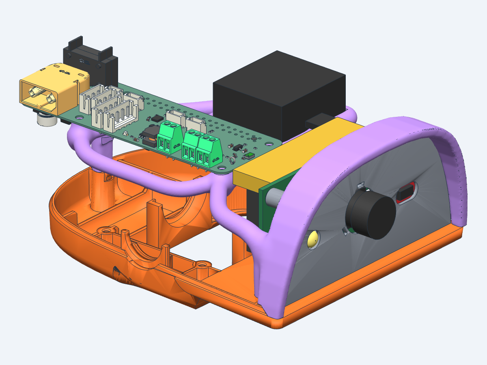
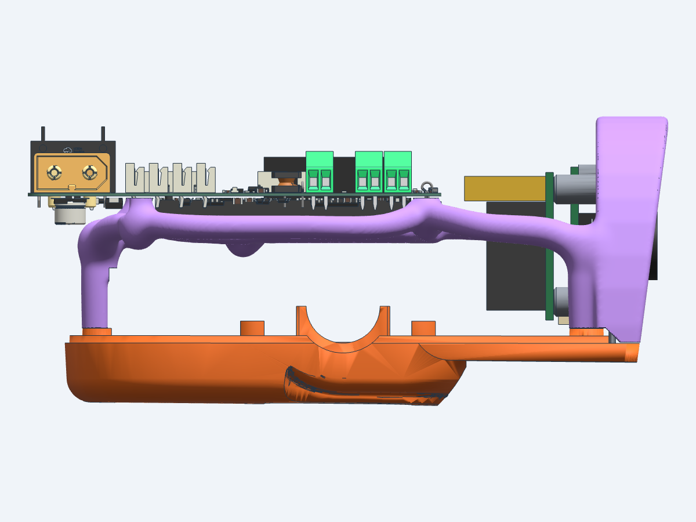
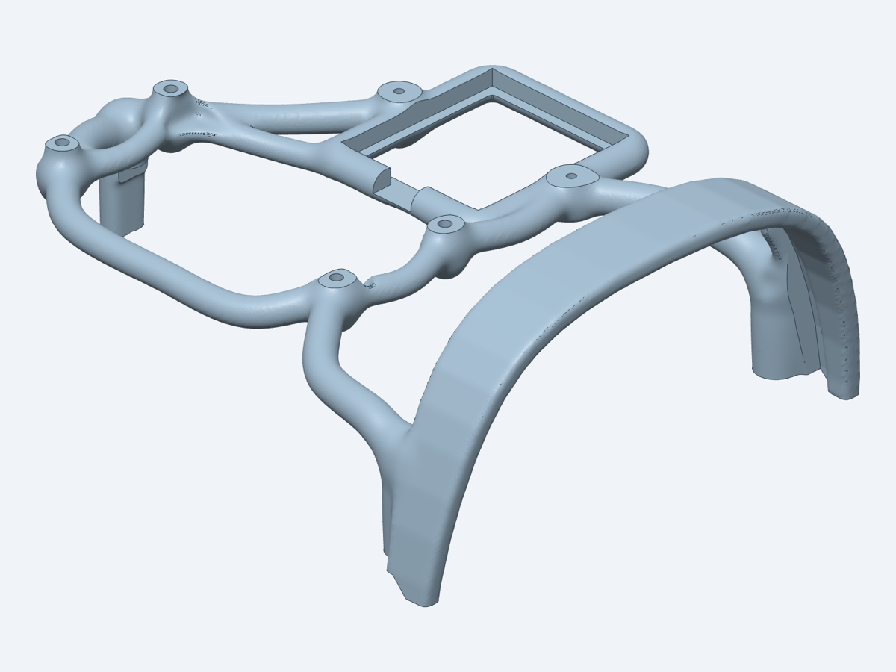

# Open head shell

An open head for development. It replaces the head's top shell (`top_head_shell` in
[`hardware/print/DuckBuddy.3mf`](../../print/README.md)) and bolts to the bottom head shell at
the same three points. It holds:

- the **[Robot HAT E1](https://code.caric.io/Robotics/elec_RPI_Robot_HAT)** on four standoffs, next to the Orange Pi Zero 3W and not on it, so the
  Pi's cooling shield stays clear. The two boards are joined by Dupont wires;
- the **speaker** QY2831F16-6R4F-PO (2 W, 6 Ω, 28 × 31 × 15 mm) in a ring beside the HAT;
- the **face plate** (with the Pi, the camera, the ToF board and an LED on its back), in a rim that frames
  it like the original top shell: over the top and down both sides to the bottom shell, so the
  head looks the same from the front. The plate for the Radxa Camera 8M 219, the SparkFun
  Mini ToF and the LED is in [`../face-plate`](../face-plate/README.md).

The electronics stay exposed on purpose. There are no microphone holders.

The frame is organic, like a topology-optimized part: tapered round branches grow from the
three screw bosses and split towards the HAT standoffs, the speaker ring and the face rim, with
smooth blends where they meet. Wherever a branch would come too close to another part of the
head, it is trimmed back with a smooth edge.







## Print

| File | Use |
|---|---|
| `STL/open_head_shell.stl`, `3MF/open_head_shell.3mf` | printing (the same mesh) |

The shell is made as a mesh, so there is no STEP file with editable surfaces: change it in
`src/organic_shell.py` and generate it again.

PETG, 0.2 mm layers, 2 walls, 30% infill, as the other parts in `hardware/print`. Print it as
modelled, screw bosses on the bed, with **tree supports**: the branches run 16 to 25 mm above
the bed, and the rim's brim over the face plate is a 3.5 mm plate 42 mm up. About
120 × 95 × 46 mm, 17.6 cm³.

## Parts and assembly

| Item | Qty | Where |
|---|---|---|
| M3 × 12 self-tapping screw | 3 | from below, through the bottom head shell into the shell's bosses |
| M2.5 × 8 self-tapping screw | 4 | through the HAT's mounting holes into the standoffs |
| M2 × 6 self-tapping screw | 2 | through the speaker's ear holes into the ear bosses |
| Dupont wires, female-female, about 10 cm | as needed | Pi 40-pin header to male pins soldered on top of the HAT |

1. **Drill the three holes of the bottom head shell to 3.2 mm.** They are printed at 2.7 mm, for
   the old top shell's M2.5 screws. The shell's bosses have 2.5 mm pilots, 12 mm deep, for M3.
2. Put the face plate (with the camera and the Pi on it) into the bottom shell as before, then
   set the open shell on top: the rim's slot slides over the plate's top and side edges.
3. Screw the shell down with the three M3 screws from below.
4. Set the speaker in its ring and screw its ears down. The wire leaves through the opening in
   the ring on the HAT side and goes to the HAT's speaker terminal (J1).
5. Solder male pin headers on top of the HAT, screw the HAT on the four standoffs, component
   side up, XT60 to the back, pin header row towards the robot's left (the speaker side).
6. Join the Pi's 40-pin header (top edge of the Pi, facing back) to the HAT pins with Dupont
   wires. Pin map: [`docs/hardware/INTERFACE-CN.md`](../../../docs/hardware/INTERFACE-CN.md) section 6.

Notes:

- At the end of the head-roll range (−25° in the model) the moving neck parts come within **1 mm** of the
  parts under the HAT (U1 and the J2 terminal). This is accepted. Two 2 mm M2.5 spacers under
  the HAT would give 3 mm.
- The HAT's XT60 end overhangs the back of the head by about 7.5 mm (HAT X −46 to 38, head
  back at X −38.5). The XT60 stays empty: the battery comes through the PDB (see section 6 of
  the interface doc).
- The HAT lies flat with its axes along the head's axes (HAT x forward, y left, z up). This only
  matters if the HAT's own LSM6DSV16X is used: the robot's IMU is the one in the trunk.

## Geometry

All numbers use the **head frame**: X forward, Y to the robot's left, Z up, in mm, with the
origin on the head-roll servo axis. The model and the reference meshes use the same frame.
All dimensions are in `src/head_params.py`; the branch layout is in `src/organic_shell.py`.

| Item | Value |
|---|---|
| Screw points | back (−31.5, 0), front (67.5, ±39); contact plane Z −1.2 (bottom-shell boss tops at −1.25 to −1.38) |
| HAT | board underside at Z 25.2, mounting holes at X −23.5 / 34.5, Y 2.0 / −21.0 |
| Speaker | box bottom at Z 18.5 on a 1.8 mm ledge, centre (16, 29), ear holes 36.5 mm apart along X |
| Face rim | band 2.5 mm beyond the plate edge, over the top and both sides down to the bottom shell (Z −1.2 behind the plate, −4.1 in front); 2.5 mm lip on the back face, 1 mm on the front, 0.4 mm gap at the edge; brim front face tilted like the original shell, from X 78.3 at the plate's bottom corners to 84.1 at the top |
| Camera | Radxa Camera 8M 219 behind the face plate, board at X 64.3 to 65.9, lens out to X 81.9 (see [`../face-plate`](../face-plate/README.md)) |
| LED | 1 W LED emitter in a cup on the plate's back at Y −22.6, Z 13.5 (see [`../face-plate`](../face-plate/README.md)) |
| ToF | SparkFun Qwiic Mini ToF Imager on the plate's back, board at X 71.0 to 71.8, Y 9.9 to 35.3; the rim's back lip is trimmed around its upper outer corner |

The neck parts that move under the head reach Z 22.6 at full head roll, 7.9 mm above the top
of the motor support (Z 14.7). This matches a measurement on the robot (about 8 mm).

## Files

| Path | What |
|---|---|
| `src/organic_shell.py` | the shell generator (distance field, meshing, exact cuts) |
| `src/head_params.py` | dimensions and clearances shared by the generator, the parts and the check |
| `src/head_meshes.py` | loading the head meshes in the head frame, the neck-motion sweep |
| `src/assembly.py` | the HAT (its STEP), the speaker, the Pi with cooling shield and Dupont plugs, the camera, the ToF board and the LED, as a CAD model |
| `checks/fit_check.py` | the fit check (below) |
| `vendor/robot_hat_e1.step` | the HAT's STEP, from the [Robot HAT E1](https://code.caric.io/Robotics/elec_RPI_Robot_HAT) project ([`production/ASE01187-E1_elec_RPI_Robot_HAT_STEP.zip`](https://code.caric.io/Robotics/elec_RPI_Robot_HAT/src/branch/main/production/ASE01187-E1_elec_RPI_Robot_HAT_STEP.zip)); `.xbf` is the same, converted for fast loading |
| `reference/` | the head parts in the head frame, made by `tools/` (below) |
| `tools/` | scripts that make `reference/` |

## Build and check

The generator builds the parts with [text-to-cad](https://texttocad.dev) (`cad`), then makes
the shell (about 25 s):

```bash
uv run src/organic_shell.py
```

It writes `tmp/open_head_shell.stl` and `tmp/open_head_review.glb` (the shell with the boards,
the camera, the ToF, the LED and the speaker). It uses the face plate from `../face-plate` when that has been
built, else the DuckBuddy plate. `--res 0.5` makes a quick draft. Open the review file in the
CAD viewer:

```bash
cad viewer tmp/open_head_review.glb
```

Then check it (about 3 minutes):

```bash
uv run checks/fit_check.py
```

It checks:

- no overlap with the parts the shell rests on or holds: the bottom shell, the face plate,
  the HAT board and the speaker;
- at least 1 mm from the fixed parts in the head (servos, motor support, jaw), 0.5 mm from the
  roll servo (it sits 2.5 mm from the back screw; the old top shell touched it), 2 mm from the
  Pi and the Dupont plugs, and 1 mm from the parts under the HAT board, the camera, the ToF and the LED;
- at least 3 mm between the shell, the speaker, the camera, the ToF and the LED and the moving neck parts, 1 mm
  for the HAT, with head roll ±25° in 1° steps and head yaw ±170° in 15° steps.

Copy the checked mesh to the print files:

```bash
cp tmp/open_head_shell.stl STL/open_head_shell.stl
```

The 3MF is the same mesh, written with trimesh.

Last result: PASS. Shell 3.3 mm, HAT 1.0 mm and speaker 6.4 mm from the moving parts, the
camera, the ToF and the LED more than 20 mm; shell 0.6 mm from the roll servo, 1.3 mm from the motor
support, 2.1 mm from the soft mouth top, 1.2 mm from the parts under the HAT, 2.9 mm from the
Pi, 5.9 mm from the camera, 1.3 mm from the ToF, 8.3 mm from the LED.

## Reference meshes

`reference/` is made from two sources, and the scripts in `tools/` make it again:

| Files | Made by | From |
|---|---|---|
| `microduck/*.stl` | `tools/microduck_head_meshes.py` | the Microduck MuJoCo model (`microduck-simulator`, `app/public/robot/mjlab/robot_allcollisions.xml`), head and neck bodies, as `<body>__<mesh>__<geom id>.stl` |
| `*_duckbuddy.stl` | `tools/extract_3mf_objects.py`, then `tools/align_shells.py` | the bottom head shell, top head shell and face plate in `hardware/print/DuckBuddy.3mf`, fitted to the Microduck meshes (median error 0.3 to 0.5 mm) |
| `face_outline.json` | `tools/face_outline.py` | a section of the face plate at X 72.8 |
| `envelope.npz` | `tools/neck_envelope.py` | height maps of the moving neck parts and the fixed servos (planning only) |

Each script prints its usage when run without arguments.

## Assumptions

- The speaker's ear flange is 2 mm thick; its top is 6 mm above the box bottom (measured).
- The Pi's cooling shield is 12 mm tall.
- The head servos are the XL330 shapes of the Microduck model; the HL-2915 has the same outline
  and mounting.
- The HAT STEP models the board as a 0.6 mm solid; its underside parts end at Z 25.2, which is
  taken as the board's underside.
