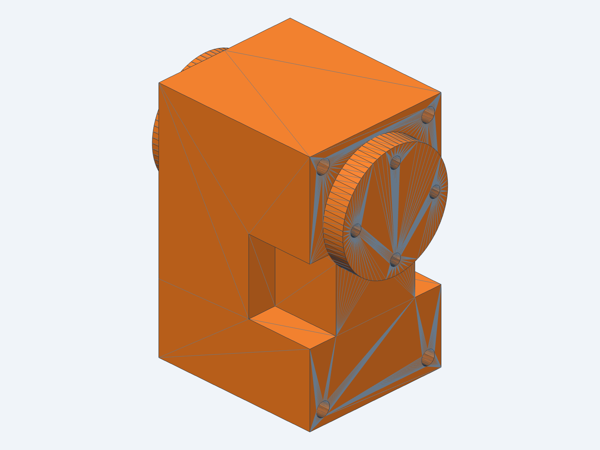

# Servo dummy

A printed stand-in for a faulty HL-2915 servo. It has the servo's outer shape, its screw holes and
both horns, all in one solid: nothing turns. Mounted the way the robot's CAD places the servo, it
holds its joint at the zero pose, so a joint whose servo is missing stays rigid while a new servo is
on its way.

The Feetech HL-2915 has the same outer shape, holes and output shaft as the Dynamixel XL330
([`hardware/print`](../../print/README.md)), so the dummy is the XL330 from the Microduck CAD
(`vendor/xl330.step`, Pollen Robotics, Apache 2.0).



## Print

| File | Use |
|---|---|
| `STL/servo_dummy.stl`, `3MF/servo_dummy.3mf` | printing (the same mesh) |

- PETG, 100 % infill: it carries the joint's load through the horn.
- Stand it on the flat end away from the horns, horns at the top; no
  supports.
- Size: 29 × 20 × 34 mm (a 23 × 20 × 34 mm body, a horn 3 mm proud on each side).

## Holes

| Where | Holes | Size | For |
|---|---|---|---|
| each horn | 4, on a 12 mm circle | Ø1.6 mm | the M2 self-tapping screws the leg and head parts use on a servo horn |
| body, through | 4, on a 30 × 16 mm rectangle | Ø2.0 mm | the M2 screws through the servo body |

Printed holes come out a little small. If a screw does not go in, drill the horn holes with 1.6 mm
and the body holes with 2.0 mm.

## Mount

Screw it in exactly as the servo it replaces, with the leg or head part on the horn at the angle the
part has with the joint at zero. There is no cable to connect.

On the brain robot (2026-11), four dummies hold both hip yaw and both hip roll joints, and robotd
leaves those joints out of the servo bus (`joint_ids` 0, set on the bring-up tool's "Joint mapping"
card).

## Where they go

`layout/robot_layout.py` makes a GLB of the whole robot at its zero pose: the printed and bought parts
light grey, the servos dark grey ("servo <joint>"), and the dummies magenta ("DUMMY <joint>"). The
dummy joints are `DUMMY_JOINTS` at the top of the script. The robot's model
(`hardware/rev-a/mjcf/robot_allcollisions.xml`) names its meshes but this repository does not hold
them, so pass the Microduck `assets` folder that does:

```bash
uv run hardware/cad/servo-dummy/layout/robot_layout.py <Microduck assets folder>
cad viewer hardware/cad/servo-dummy/layout/robot_layout.glb
```

It finds which servo drives each joint from the model itself: the servo whose horns lie on the joint's
axis. The GLB (about 13 MB) is not committed.

## Source

`src/servo_dummy.py` (build123d, text-to-cad): reads `vendor/xl330.xbf` (made from the STEP with
`cad export vendor/xl330.step vendor/xl330.xbf`) and checks that it is one valid solid of the right
size. `tools/hole_sizes.py` measures the holes from the STL.

```bash
cad run src/servo_dummy.py
cad export <id> STL/servo_dummy.stl 3MF/servo_dummy.3mf
```
